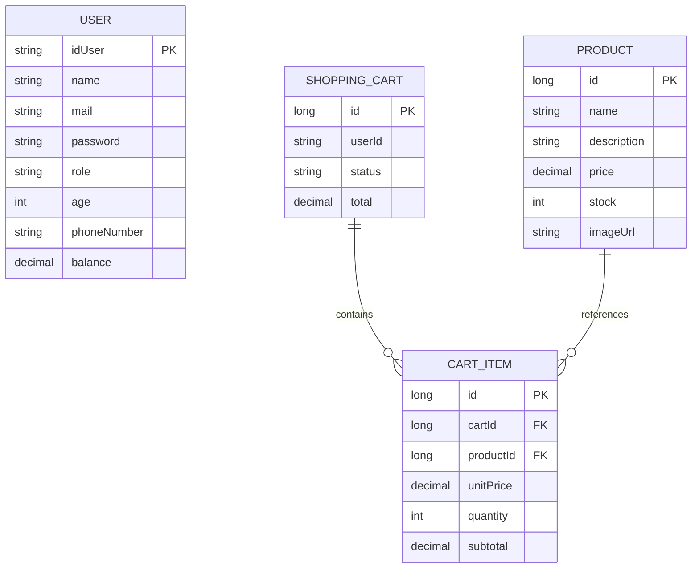

# Modelo Entidad-Relación

`USER` pertenece al microservicio Auth y `PRODUCT`, `SHOPPING_CART` y `CART_ITEM` pertenecen al microservicio Catalog.

`SHOPPING_CART.userId` es una referencia lógica al identificador de Auth. No existe una clave foránea física entre las bases de datos de Auth y Catalog.

Dentro de Catalog, `SHOPPING_CART` se relaciona uno a muchos con `CART_ITEM`, y cada `CART_ITEM` referencia un `PRODUCT`.
